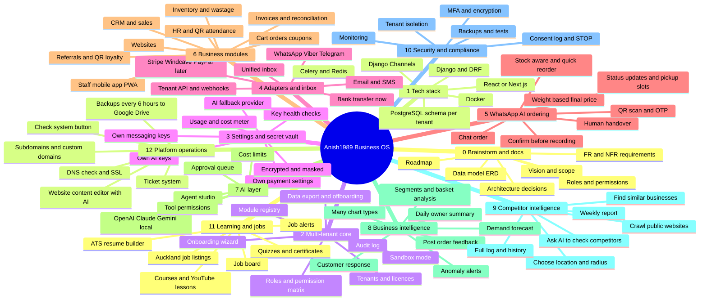

# 01. Mind map

Last updated: 21 October 2026

This mind map shows the whole platform. Each branch is explained in more detail in the other documents.

## Branch summary

| # | Branch | Purpose | Details |
|---|---|---|---|
| 0 | Brainstorm and docs | Plan before building | This folder |
| 1 | Tech stack | Tools and frameworks | [Decisions](02-decisions.md) |
| 2 | Multi-tenant core | Tenants, licences, roles, modules, audit | [Feature catalogue](03-feature-catalogue.md) |
| 3 | Settings and secret vault | Each tenant manages its own keys | [Settings and secrets](04-tenant-settings-and-secrets.md) |
| 4 | Adapters and inbox | One interface per provider type | [Settings and secrets](04-tenant-settings-and-secrets.md) |
| 5 | WhatsApp AI ordering | Order by chat, no website visit needed | [WhatsApp AI ordering](05-whatsapp-ai-ordering.md) |
| 6 | Business modules | CRM, inventory, finance, commerce, HR | [Feature catalogue](03-feature-catalogue.md) |
| 7 | AI layer | Agents with limits and approvals | [Feature catalogue](03-feature-catalogue.md) |
| 8 | Business intelligence | Charts and customer response | [Business intelligence](06-business-intelligence.md) |
| 9 | Competitor intelligence | Weekly competitor reports | [Competitor intelligence](07-competitor-intelligence.md) |
| 10 | Security and compliance | Protect data and follow NZ rules | [Feature catalogue](03-feature-catalogue.md) |
| 11 | Learning and jobs | Courses, job board, resume builder | [Industry templates](09-industry-templates.md) |
| 12 | Platform operations | Domains, content editor, tickets, health checks, backups | [Platform operations](11-platform-operations.md) |
