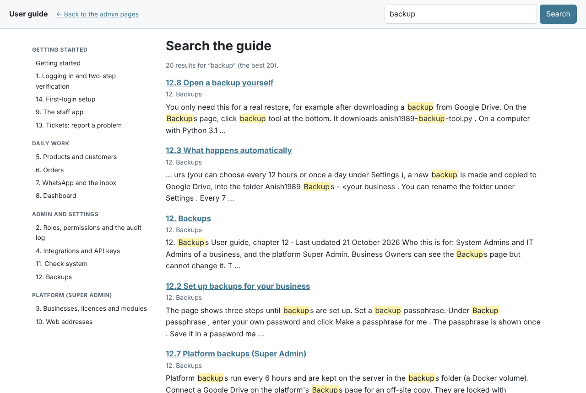

# Getting started

*User guide · Last updated 22 October 2026*

Anish1989 Business OS runs your business in one place: products, customers, orders, WhatsApp messages, a dashboard, and more modules later. Each business has its own address, for example `gorkhabutchery.<platform address>`, and its own data. No other business can see it.

## Who uses what

| You are | You use | Start with |
|---|---|---|
| **Owner or admin** (System Admin, IT Admin) | The **admin pages** (`/admin/`) | [Log in](01-logging-in-and-two-step-verification.md), then the [first-login setup](14-first-login-setup.md) |
| **Staff** (counter, kitchen, sales) | The **staff app** (`/app/`) on a phone, tablet or computer | [Log in](01-logging-in-and-two-step-verification.md), then the [staff app](09-staff-app.md) |
| **Platform Super Admin** | The platform site and the admin pages there | [Businesses, licences and modules](03-businesses-licences-and-modules.md) |

## Your first day as an owner or admin

1. **Log in** with the email and the link from your invitation, and set up **two-step verification** with an authenticator app (chapter 1).
2. The **setup** opens by itself (chapter 14). Fill in your business details, set up **backups to your Google Drive**, and look at the connections.
3. **Add your staff**: admin pages → **Users** → **Add**. Give each person a role, for example **Shop Staff** (chapter 2).
4. **Add your products**, one by one or from a CSV file (chapter 5).
5. Set your **pickup and delivery** hours, time slots and delivery areas with their fees (chapter 15).
6. Connect **email sending** and **WhatsApp** on the **Integrations** page (chapters 4 and 7).
7. Open the **Dashboard** to see today's sales and orders (chapter 8).

## Your first day as staff

1. Open the link your manager gives you and **log in**. Staff who use the admin pages also set up two-step verification (chapter 1).
2. Open the **staff app** at `/app/`. You can add it to your phone's home screen.
3. Take **orders**, look up **customers**, and answer **WhatsApp** messages if your role allows it (chapters 6, 7, 9 and 15).

## When something goes wrong

- Click **Report a problem** at the top of any admin page. Your admins see it and can answer you (chapter 13).
- Admins can click **Check system** to test everything in a few seconds (chapter 11).
- Every admin page has a **Help** link at the top. It opens the chapter about that page.
- Deleting asks a small sum and waits 5 seconds, so nothing is deleted by accident (chapter 16.5).

## Find your way in this guide

- The list of chapters is on the left (on a phone, at the bottom).
- Use **Search** at the top: type a word or two, for example “backup” or “password”.
- Words in **bold** are buttons, links or field names you see on the screen.

