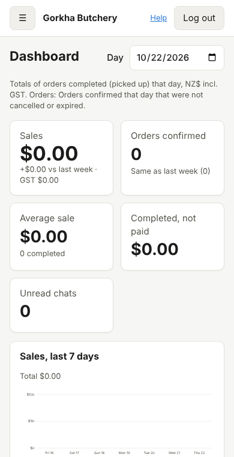

# 9. The staff app

*User guide, chapter 9 · Last updated 23 October 2026*

**Who this is for:** counter staff, kitchen staff, managers and owners.

The staff app is a simple screen for daily work: taking orders, weighing meat, replying to customers and checking today's numbers. It works on a computer, a tablet or a phone.

Settings, roles, users and editing products still happen in the **classic admin** (`/admin/`).

## 9.1 Opening the app

1. Go to your business address followed by `/app/`. For example: `https://gorkhabutchery.<platform address>/app/`.
2. Enter your email and password, then click **Log in**.
3. If you use two-step verification, type the 6-digit code from your authenticator app (or one of your backup codes). See chapter 1.
4. The app opens the first page your role can use.

Forgotten your password? Click **Forgotten your password?** on the login screen (chapter 1).

Tip: on a phone or tablet, add the page to your home screen so it opens like an app.

## 9.2 The menu

You only see the pages your role allows:

| Menu item | Shown when your role has |
|---|---|
| **Dashboard** | Reports – View (chapter 8) |
| **Orders** | Orders – View |
| **Board** | Orders – View. The live order board for the counter, the kitchen or a TV (chapter 19). |
| **Inbox** | Customers – View. A blue number shows unread chats. |
| **Products** | Products – View |
| **Enquiries** | Catering and events – View. Event and catering enquiries (chapter 23). |
| **Customers** | Customers – View |
| **Website** | Websites – View. Write and publish the business's website (chapter 22). |
| **Classic admin** | Always shown. It opens the full admin for settings, roles and users. |

If a module is switched off for your business, its page disappears from the menu.

- **On a computer:** click **«** to make the menu narrow (icons only) and **»** to show the labels again. The app remembers your choice on that computer.
- **On a phone:** tap **☰** to open the menu. Your name, the colour theme and **Two-step verification** are at the bottom of the menu.
- **Theme:** choose **Theme: device** (follows your device), **Light** or **Dark**.
- **Log out:** top right. Always log out on a shared device.

## 9.3 Orders

The **Orders** page lists open orders first. You can:

- choose **Open orders** or **All orders**, and filter by status;
- search by order number (for example `#1001`) or customer name;
- tap an order to open it.

### Taking a new order

1. Click **+ New order**.
2. **Customer:** type a name or phone number and pick the customer. If they are new, add them first in the classic admin (chapter 5).
3. Choose the **channel** (Counter, Phone, WhatsApp or Website), then **Pickup** or **Delivery**, the address for a delivery, and the **time** (chapter 15).
4. **Products:** type a product name or code and pick it. Enter the amount. The app shows the smallest amount and the steps allowed (for example "min 0.5, steps of 0.5" for kg).
5. Add a note for a line if needed (for example "curry cut, small pieces"), and a note for the whole order at the bottom.
6. Check the **Estimate** and click **Save as draft**.

The estimate on the screen is only a guide. The server always checks prices again when the order is saved.

### Working on an order

The order page shows the lines, the total with GST included, and these boxes:

- **Real weight:** when the order is being prepared, type the real weight of each kg item and click **Save weights**. The total changes and "Estimate was …" shows the old amount.
- **Next step:** the buttons show only the steps allowed now (for example **Confirmed**, **Being prepared**, **Ready for pickup** or **Ready for delivery**, **Out for delivery**, **Completed**). Chapter 6 explains each status.
- **Cancel:** type a reason, then click **Customer cancelled** or **Shop cancelled**. A reason is required.
- **Payment:** choose how the customer paid and click **Mark as paid**.
- **History:** every change, with the time and who made it.

On a phone, each order line is shown as a small block (product, ordered, real weight, price, line total), so nothing is hidden at the side.

## 9.4 Inbox

The **Inbox** lists WhatsApp conversations. Tap one to read it and reply.

- Type your reply and tap **Send**.
- WhatsApp allows free replies only within **24 hours** of the customer's last message. After that, the app shows a note with a link to the classic inbox page, where you can send an approved template (chapter 7).
- **Make enquiry** turns the chat into an event or catering enquiry (Catering and events – Create, chapter 23.6).

## 9.5 Products and customers

These pages are for looking things up quickly:

- **Products:** search by name, code or another name. You see the price and whether it is available.
- **Customers:** search by name, phone, email or tag. You see whether the customer agreed to marketing messages.

To add or change products or customers, click **Edit products (classic admin)** or **Edit customers (classic admin)**. These buttons only appear if your role may edit.

## 9.6 If something goes wrong

| What you see | What to do |
|---|---|
| "Nothing to show yet" after login | Your role has no pages yet. Ask your System Admin to give you a role (chapter 2). |
| "You do not have permission …" | Your role does not allow that action. Ask your manager. |
| You are sent back to the login screen | Your session ended. Log in again. |
| "The staff screens are not built yet" | The app was not built on this server. Tell your IT Admin (developer setup guide). The classic admin still works. |
