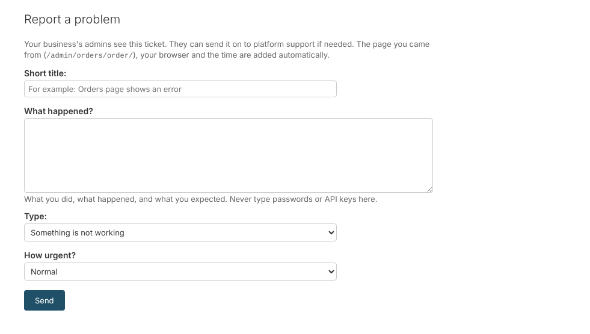
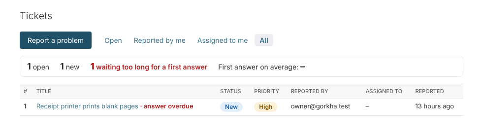

# 13. Tickets: report a problem

*User guide, chapter 13 · Last updated 21 October 2026*

**Who this is for:** everyone who uses the admin pages. Handling tickets is for System Admins, IT Admins and managers with the Tickets permissions. The platform's own support team uses the same pages on the platform site.

## 13.1 Report a problem

1. On any admin page, click **Report a problem** at the top right.
2. Write a **short title** and **what happened**: what you did, what happened, and what you expected.
3. Choose the **type** (something is not working, a question, or a request) and **how urgent** it is.
4. Click **Send**.

The page you came from, your browser and the time are added automatically. Only the page's path is kept, never the rest of the link, because links can hold private codes. **Never type passwords or API keys in a ticket.**

You get an email when someone answers or changes the status. Click **Tickets** at the top to see your tickets. You can add messages to them, for example to answer a question.

## 13.2 Who sees a ticket

| Person | Sees |
|---|---|
| The person who reported it | Their own tickets, without internal notes |
| People with **Tickets – Edit** (System Admin, Operations Manager, Department Manager, Support Agent, and others) | Every ticket of the business |
| People with **Tickets – Assign** | Can also assign tickets and send them to platform support |

Another business never sees your tickets.

## 13.3 Handle tickets

Open **Tickets**. The tabs show **Open**, **Reported by me**, **Assigned to me** and **All** tickets. At the top: open tickets, new tickets, tickets waiting too long for a first answer, and the average time to the first answer.

On a ticket you can:

- **Answer.** The reporter gets an email.
- Tick **Internal note** to write something only the team sees.
- Change the **status**:

  | Status | Meaning |
  |---|---|
  | New | Nobody has looked at it yet |
  | In progress | Someone is working on it |
  | Waiting for reply | Waiting for the reporter (it goes back to In progress when they answer) |
  | Resolved | Fixed |
  | Closed | Finished |

- **Assign** it to a person. They get an email.

**First answer targets:**

| Priority | First answer within |
|---|---|
| Urgent | 1 hour |
| High | 4 hours |
| Normal | 24 hours |
| Low | 3 days |

A ticket without an answer after this time shows **answer overdue**.

## 13.4 Send a ticket to platform support

If your team cannot fix it, open the ticket and click **Send to platform support**. You can add a note. The platform team gets a copy (title, description, page and browser) and an email.

Their answers and status changes show on your ticket under **Platform support**, and the person who sent it gets an email. You can answer them from there. Platform support never sees your internal notes or your other tickets.

## 13.5 Automatic tickets

- When the **hourly Check system** run finds a red result (chapter 11), a ticket is created.
- When an **automatic backup or restore test** fails (chapter 12), a ticket is created.

There is only one open ticket per problem. If the same problem happens again, a message is added to the open ticket. When the ticket is resolved and the problem comes back, a new ticket is made. On the Check system page and the Backups page, a red result also has a **Create ticket** button.

The business must use the **Tickets** module for this (it is on for most business types).

## 13.6 Platform support (Super Admin, Platform Support Admin)

On the platform site, **Tickets** shows the tickets that businesses sent on, and tickets platform admins reported themselves. The **Business** column shows where a ticket came from. Answers that are not internal notes are shown to the business and emailed to the person who sent it.
