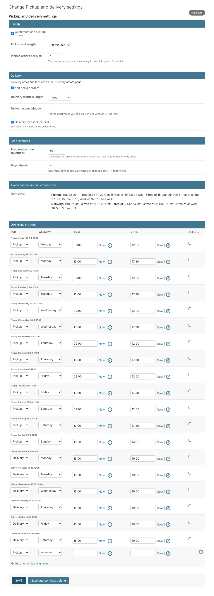
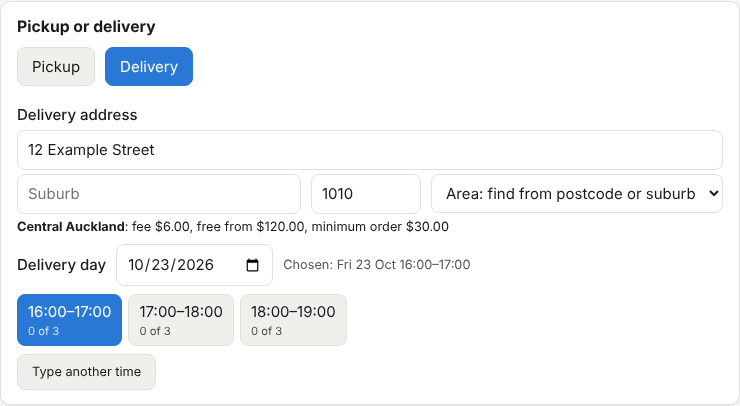

# 15. Pickup and delivery

*User guide, chapter 15 · Last updated 22 October 2026*

**Who this is for:** business owners and managers who set opening hours, time slots and delivery fees, and staff who take orders.

Customers can pick up their order or have it delivered. You decide when, how many orders fit in each time slot, where you deliver and what delivery costs. Customers pay when they pick up the order or when it is delivered (cash, card or bank transfer); there is no payment inside WhatsApp.

## 15.1 Who can do what

| Role (default) | Pickup and delivery |
|---|---|
| Business Owner, Operations Manager, System Admin | Change the settings, opening hours, closed days and delivery areas (permission **Orders – Configure**) |
| Shop Staff and others who can see orders | See the settings and areas, choose pickup or delivery and a time on orders |

Roles that already had **every** Orders permission received **Orders – Configure** automatically. To give it to another role, tick **Orders – Configure** in that role (chapter 2).

## 15.2 Settings

Go to **Pickup and delivery → Pickup and delivery settings**.



| Setting | What it does | Example |
|---|---|---|
| Customers can pick up orders | Pickup on or off | On |
| Pickup slot length | Customers choose a time in steps of this length | 30 minutes |
| Pickup orders per slot | The most orders you can have ready in one slot. 0 = no limit | 5 |
| You deliver orders | Delivery on or off | On |
| Delivery window length | Customers choose a delivery window of this length | 1 hour |
| Deliveries per window | The most deliveries in one window. 0 = no limit | 3 |
| Delivery fees include GST | The fee includes 15% GST (switch off if you are not GST-registered) | On |
| Preparation time | A customer can only choose a slot that starts at least this long after ordering | 60 minutes |
| Days ahead | How far ahead customers can choose (1 = today only) | 7 |

**Times customers can choose now** shows, for each of the next days, how many slots are still free. Use it to check your settings.

## 15.3 Opening hours

At the bottom of the settings page, add one line for each period:

- **For**: Pickup or Delivery (they have separate hours).
- **Weekday**, **From** and **Until**, for example *Monday, 09:00, 17:00*.
- A day can have two periods, for example *09:00–12:00* and *13:00–17:00* for a lunch break. Periods on the same day must not overlap.
- A day with no line has no pickup (or no delivery).

Click **Save**. With 30-minute pickup slots, *09:00–12:00* gives six slots: 09:00, 09:30 … 11:30.

> **Note:** with no opening hours, customers cannot choose a time at all. Staff can still type a time.

## 15.4 Closed days

Go to **Pickup and delivery → Closed days → Add closed day**. Choose the **date** and a **reason** (for example *Christmas Day*; customers may see it). Closed days have no pickup and no delivery slots.

## 15.5 Delivery areas and fees

Go to **Pickup and delivery → Delivery areas → Add delivery area**.

| Field | What it does |
|---|---|
| Name | For example *Central Auckland*. Customers may see it. |
| Postcodes | 4-digit postcodes separated by commas, for example *1010, 1011, 1021* |
| Suburbs | Suburb names separated by commas, for example *Mount Roskill, Three Kings*. *Mt* and *Mount* are treated the same. |
| Delivery fee | Added to the order total |
| Minimum order | Products must cost at least this much (fee not counted). 0 = no minimum |
| Free delivery from | No fee when the products cost at least this much. Empty = never free |
| Delivering here now | Switch off to stop delivering to this area for a while |

The area of an address is found by **postcode first**, then by **suburb**. A postcode or suburb can only be in one active area. An area used by orders cannot be deleted: switch **Delivering here now** off instead.

The fee is copied onto the order. If you change a fee later, orders already made keep their fee.

## 15.6 Choosing pickup or delivery on an order

In the staff app (**New order**) and on an order's page (**Change**):



1. Choose **Pickup** or **Delivery**.
2. For delivery, type the **address**, **suburb** and **postcode**. The area and its fee appear below. If no area matches, choose one from **Area**, or check the address. When you change the address later, the area is found again.
3. Choose the **day**, then a **time**. Each button shows how many orders are already in that slot, for example *2 of 5*. Slots that are **full**, **too soon** or in the **past** have a dashed border.
4. For an exact time outside the slots (for example a regular customer at 07:30), click **Type another time**.

In the business admin, the same fields are on the order page (**Orders → Orders**).

## 15.7 Rules for customers and for staff

- **Customers** (WhatsApp AI and website orders, coming in the next tasks) can only choose a free slot, after the preparation time, within the days ahead, in an area you deliver to, and above the minimum order.
- **Staff** may book outside these rules, for example a full slot or a time before opening. The order then shows **Check before you go on** with the reasons, until it is ready.
- A **delivery** order always needs an address, an area and a time before it can be sent to the customer or confirmed.
- After the order is confirmed, the time and address can still change (it is written in the history). Changing pickup to delivery, or the area, changes the fee: that is not possible while the order is marked as paid.

## 15.8 The steps of a delivery order

```
… → Being prepared → Ready for delivery → Out for delivery → Completed
```

- **Ready for delivery**: packed and waiting for the driver.
- **Out for delivery**: on the way. The address and time can no longer change.
- If nobody was home, move it back to **Ready for delivery** and write the reason, for example *Nobody home, try again at 6 pm*.
- **Completed**: delivered. Mark the order as paid when the customer pays the driver.

Pickup orders go **Ready for pickup → Completed** as before (chapter 6).
