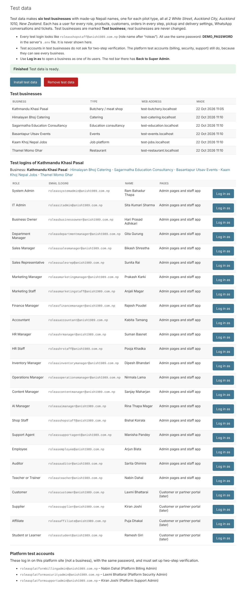

# 16. Test data, Log in as, and deleting safely

*User guide, chapter 16 · Last updated 22 October 2026*

**Who this is for:** the platform Super Admin (test data and Log in as). Section 16.5 (deleting) is for everyone.

## 16.1 What test data is

**Install test data** makes six test businesses with made-up Nepali names, one for each pilot type:

| Business | Type | Web address (laptop) |
|---|---|---|
| Kathmandu Khasi Pasal | Butchery | `test-butchery.localhost` |
| Thamel Momo Ghar | Restaurant | `test-restaurant.localhost` |
| Himalayan Bhoj Catering | Catering | `test-catering.localhost` |
| Basantapur Utsav Events | Events | `test-events.localhost` |
| Sagarmatha Education Consultancy | Education consultancy | `test-education.localhost` |
| Kaam Khoj Nepal Jobs | Jobs | `test-jobs.localhost` |

Each one is at **2 White Street, Auckland City, Auckland 1010, New Zealand** and has:

- a user for **every role**, with a Nepali name;
- business details, pickup and delivery hours, closed days and delivery areas;
- categories and products (with prices, cost prices and Nepali search words);
- stock for the butchery, restaurant, catering and events products: a delivery, the orders taking stock, some waste, one product **Low** and one **Out of stock** (services such as visa help and job adverts are not counted);
- 16 customers (emails end with `@example.com`, which can never receive email);
- orders in every step: completed orders of the last days (for the dashboard), and open orders from Draft to Out for delivery;
- WhatsApp conversations and tickets;
- WhatsApp messages about the orders (confirmed, final price answered Yes, ready, on the way). They are **made up and were never sent**: test businesses never connect WhatsApp, because the made-up phone numbers could belong to real people;
- AI assistant settings and two made-up AI chats (one order the AI sent to confirm, one chat handed to staff). No AI key is saved, so the AI never answers there.

Test businesses are marked **Test business** in the business list. Real businesses are never changed.

## 16.2 The test logins

Every test login is `roleas` + the role name + `@anish1989.com.np`, for example:

| Role | Login |
|---|---|
| System Admin | `roleassystemadmin@anish1989.com.np` |
| Business Owner | `roleasbusinessowner@anish1989.com.np` |
| Shop Staff | `roleasshopstaff@anish1989.com.np` |
| AI Manager | `roleasaimanager@anish1989.com.np` |

The same logins exist in each test business; you choose the business by its web address. All test logins use the **same password**: the `DEMO_PASSWORD` line in the server's `.env` file. It is never shown on any page and never saved on GitHub.

- Test logins in test businesses do **not** ask for two-step verification.
- The platform test logins (`roleasplatformbillingadmin@…`, `roleasplatformsecurityadmin@…`, `roleasplatformsupportadmin@…`) work on the platform site and **must** set up two-step verification, because they can see every business. There is never a test Super Admin.

> **Note:** anyone who knows `DEMO_PASSWORD` can open the test businesses. Use a password that you do not use anywhere else, and remove the test data when you no longer need it.

## 16.3 Install and remove test data

1. On your laptop, add the line `DEMO_PASSWORD=your-test-password` to the `.env` file (your own password, at least 8 characters), then restart the app.
2. Log in to the platform site as the Super Admin and click **Test data** at the top.
3. Click **Install test data**. It takes about 2 minutes; the page updates by itself until it says **Finished**.
4. Pick a business under **Test logins** to see its logins.

To start again, click **Remove test data**, answer the safety check (16.5), then install again. **Remove test data** deletes only the test businesses and the platform test logins.

The person who runs the server can do the same with `python manage.py install_test_data` and `python manage.py remove_test_data`.

## 16.4 Log in as (Super Admin only)

**Log in as** opens a business exactly as one of its users sees it. No password is needed.

1. On the platform site, open **Test data** (test businesses), or **Businesses and users** → a business (any business).
2. Click **Log in as** next to the person. For a **real** business, first write why (for example *Checking a printer problem for Sita*).
3. The business opens in the same browser tab. A **red bar** at the top says who you are logged in as.
4. Click **Back to Super Admin** in the red bar to come back. Your Super Admin login on the platform site stays open the whole time.

Rules:

- Only the Super Admin can use it. The link works once and only for 60 seconds.
- The session ends by itself after **60 minutes**.
- Both audit logs record it: the platform's (*security.login_as*) and the business's (*login_as_started* and *login_as_ended*, by "platform administrator").

## 16.5 Deleting safely (everyone)

Deleting cannot be undone, so every delete in the admin pages asks for more than one click:

1. The page lists what will be deleted.
2. Answer the **small sum**, for example *What is 4 + 7?*
3. The **Delete** button works only after **5 seconds**.
4. A last question asks *Delete permanently?* Click **OK**.

This applies to deleting one record, to **Delete selected**, and to the **Remove** buttons for integrations, web addresses and test data. A wrong answer, or clicking too fast, deletes nothing and shows why. Each sum works once; after 15 minutes the page needs a new sum.
