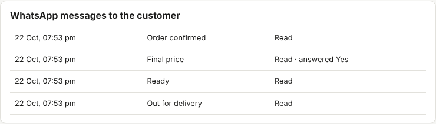
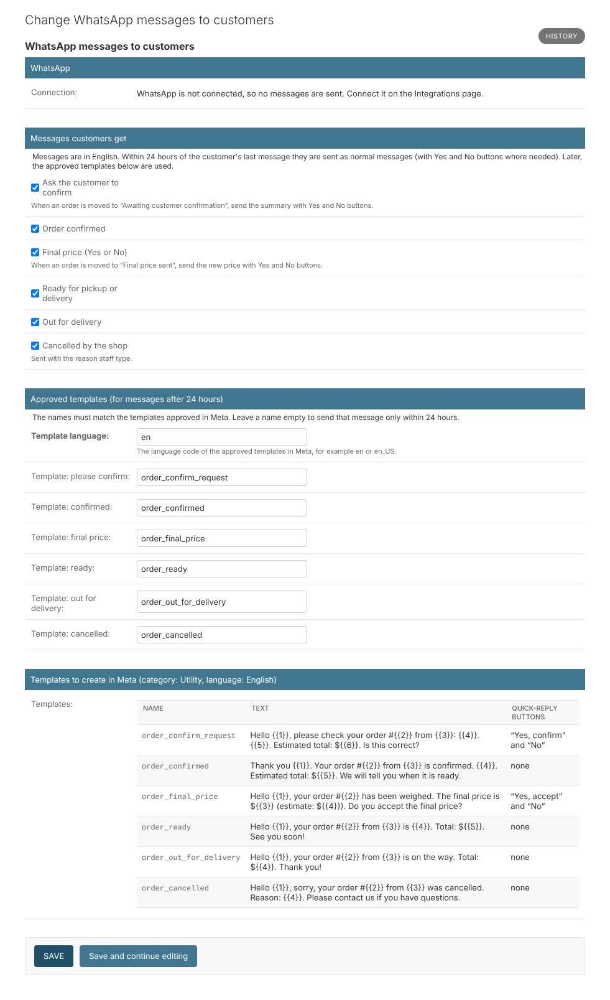

# 17. WhatsApp messages about orders

*User guide, chapter 17 · Last updated 22 October 2026*

**Who this is for:** staff who take orders (sections 17.1–17.4) and the business owner or manager who sets up the messages and the Meta templates (sections 17.5–17.7).

When an order moves to certain steps, the customer automatically gets a WhatsApp message. Two of these messages ask a question with **Yes** and **No** buttons: *please confirm your order* and *do you accept the final price*. The customer's answer moves the order on by itself.

The messages are in **English** for now. Nepali messages will come later.

## 17.1 Which messages customers get

| When the order moves to | The customer gets | Buttons |
|---|---|---|
| Awaiting customer confirmation | The order summary: products, pickup or delivery, time, estimated total. "Is this correct?" | **Yes, confirm** / **No** |
| Confirmed | "Your order is confirmed", with the time and the estimated total | – |
| Final price sent | The final price after weighing, and the estimate | **Yes, accept** / **No** |
| Ready for pickup / Ready for delivery | "Your order is ready", with the total | – |
| Out for delivery | "Your order is on the way", with the total (and "pay on delivery" if not paid) | – |
| Cancelled by shop | "Sorry, your order was cancelled", with the reason you typed | – |

Nothing is sent for *Being prepared*, *Completed*, orders the **customer** cancelled, or expired orders. *Ready* is not sent again when a delivery did not happen and the order goes back to *Ready for delivery*.

Each message can be switched off (section 17.5).

## 17.2 Ask the customer to confirm a phone or counter order

1. Make the order as usual (chapter 6), with the customer and the pickup or delivery time.
2. Click **Awaiting customer confirmation**. The customer gets the summary with **Yes, confirm** and **No**.
3. Their answer:
   - **Yes:** the order becomes **Confirmed**, and the customer gets the "confirmed" message. Customer rules apply here: the time slot must be free, the delivery area active and the stock enough (chapters 15 and 5.5).
   - **Yes, but a rule stops it** (for example the slot is now full): the order goes back to **Draft**, the customer is told you will contact them, and the order shows *Customer said Yes on WhatsApp, but the order could not be confirmed: …*
   - **No:** the order goes back to **Draft**, the customer is told you will contact them, and the order shows *Customer said No on WhatsApp. Call the customer.*

If the customer does not answer within 60 minutes, the order becomes **Expired** (chapter 6.8).

## 17.3 The final price

After weighing (chapter 6.4), click **Final price sent**. The customer gets the new price with **Yes, accept** and **No**.

- **Yes:** the order becomes **Final price accepted**. Then click **Ready for pickup** (or **Ready for delivery**) as usual.
- **No:** the order goes back to **Being prepared**, and the order shows *Customer said No to the final price ($…) on WhatsApp. Call the customer.* Call them, weigh again if needed, and go on.

Customers can also **type** their answer: *yes*, *ok*, *ho* or *no*, *hoina*. A typed answer only counts when the customer has exactly one open question. Otherwise it stays in the inbox for you to answer.

An old button never changes an order that has moved on. If the customer presses one, they get "This question was already answered or has changed".

## 17.4 See what was sent

Open the order. **WhatsApp messages to the customer** lists every message, when it was sent and what happened: *Sent*, *Delivered*, *Read*, *answered Yes* or *answered No*, or **Not sent** with the reason.

The messages also appear in the customer's conversation in the **Inbox** (chapter 7).

| Not sent because… | What to do |
|---|---|
| WhatsApp is not connected | Connect it (chapter 7.5), and call the customer this time. |
| The customer has no phone number | Add their phone number (chapter 5), or tell them yourself. |
| More than 24 hours since the customer's last message, and no template is set | Set up the templates (section 17.6), and call the customer this time. |
| The order moved on before the message was sent | Nothing: the message was no longer right. |
| WhatsApp refused the message (code …) | See the code in Meta's documentation; often the number has no WhatsApp. |

Messages are sent by the background worker, usually within seconds. **Check system** warns when messages wait longer than 10 minutes (the worker may have stopped) or were not sent in the last 24 hours (chapter 11).

## 17.5 Settings (Orders – Configure)

Go to **Orders → WhatsApp messages to customers**.

- **Messages customers get:** untick a message to stop sending it.
- **Approved templates:** the names of your templates in Meta (section 17.6) and their language code (*en* or *en_US*, as approved). Leave a name empty to send that message only within 24 hours of the customer's last message.

## 17.6 Templates in Meta (for messages after 24 hours)

WhatsApp only lets a business send a normal message within **24 hours** of the customer's last message. After that, only **templates** approved by Meta can be sent. Customers who order by WhatsApp have usually written recently, so most messages go as normal messages. Templates are for the other cases, for example a phone order, or an order for tomorrow that is ready the next day.

Create each template in **Meta Business Suite → WhatsApp Manager → Message templates**:

- **Category:** Utility. **Language:** English (the code must match the settings, for example *en*).
- **Name** and **text** exactly as shown at the bottom of the settings page (also listed below). {{1}}, {{2}}… are filled in by the system.
- For *order_confirm_request* and *order_final_price*, add two **quick-reply buttons**, in this order: **Yes, confirm** and **No** (or **Yes, accept** and **No**).

| Name | Text |
|---|---|
| order_confirm_request | Hello {{1}}, please check your order #{{2}} from {{3}}: {{4}}. {{5}}. Estimated total: ${{6}}. Is this correct? |
| order_confirmed | Thank you {{1}}. Your order #{{2}} from {{3}} is confirmed. {{4}}. Estimated total: ${{5}}. We will tell you when it is ready. |
| order_final_price | Hello {{1}}, your order #{{2}} has been weighed. The final price is ${{3}} (estimate: ${{4}}). Do you accept the final price? |
| order_ready | Hello {{1}}, your order #{{2}} from {{3}} is {{4}}. Total: ${{5}}. See you soon! |
| order_out_for_delivery | Hello {{1}}, your order #{{2}} from {{3}} is on the way. Total: ${{4}}. Thank you! |
| order_cancelled | Hello {{1}}, sorry, your order #{{2}} from {{3}} was cancelled. Reason: {{4}}. Please contact us if you have questions. |

Meta usually approves Utility templates within minutes to a day. You can change the names in the settings if Meta asks for different ones.

## 17.7 Costs

Since **1 October 2026**, Meta charges **per message** for normal messages and for Utility templates, at your country's rate. Your Meta Business account needs a **payment method**, or Meta stops sending normal messages. Check Meta's current prices: [WhatsApp pricing](https://developers.facebook.com/documentation/business-messaging/whatsapp/pricing). To send fewer messages, switch some off (section 17.5).
