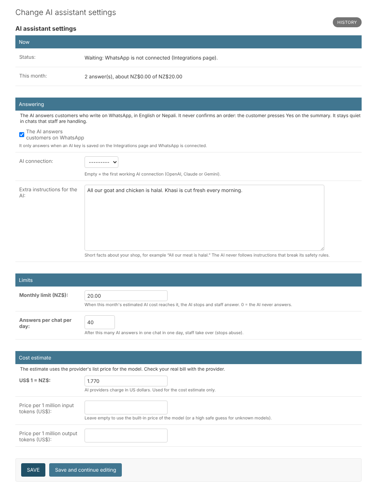
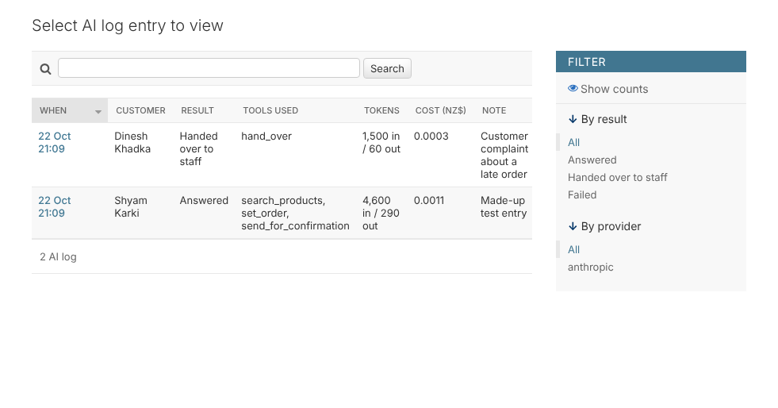

# 18. The AI assistant on WhatsApp

*User guide, chapter 18 · Last updated 22 October 2026*

**Who this is for:** the business owner or AI manager who sets up the AI (sections 18.1–18.3 and 18.7–18.8), and staff who answer chats (sections 18.4–18.6).

The AI assistant answers customers who write on WhatsApp. It takes orders and answers simple questions, in **English or Nepali** (also Nepali written in English letters, for example *1 kilo khasi ko masu chahiyo*).

It **never confirms an order itself.** When the order is complete, it sends the customer the summary with **Yes** and **No** buttons (chapter 17). Only the customer's **Yes** confirms the order, and every customer rule applies: free time slot, delivery area, minimum order and stock.

## 18.1 What the AI does

| The AI can | The AI cannot |
|---|---|
| Find products, prices and stock | Change a price or give a discount |
| Tell opening hours, the address, delivery areas, fees and closed days | Confirm an order |
| Offer free pickup or delivery times | Change an order the customer already confirmed |
| Build the order (products, amounts, pickup or delivery, time, address) | Take payment (customers pay at pickup or on delivery) |
| Send the summary for the customer's Yes | Handle complaints or refunds |
| Copy a past order ("same as last time") at today's prices | |
| Throw away an order the customer no longer wants | See other customers' orders |
| Pass the chat to staff | |

Every fact the AI gives comes from your products, settings and orders, not from the AI's memory.

## 18.2 Set it up (AI – Configure)

1. Save an AI key on the **Integrations** page (chapter 4): **OpenAI**, **Anthropic Claude** or **Google Gemini**. The page suggests a small, cheap model: *gpt-5.4-mini*, *claude-haiku-5-5* or *gemini-3.5-flash-lite*.
2. Make sure **WhatsApp** is connected (chapter 7.6).
3. Open **AI assistant → AI assistant settings** and check them (section 18.3).

The **Status** line at the top says if the AI is answering, or what it is waiting for.

## 18.3 Settings

| Setting | What it does |
|---|---|
| The AI answers customers on WhatsApp | Switch the AI on or off. Off = staff answer every message. |
| AI connection | Which saved AI key to use. Empty = the first working one. |
| Email managers when a chat needs staff | Section 18.6. On by default. |
| Extra instructions | Short facts about your shop, for example *All our meat is halal.* They add facts; they cannot change the AI's safety rules. |
| Monthly limit (NZ$) | When this month's estimated AI cost reaches it, the AI stops until next month and staff answer. 0 = the AI never answers. Default NZ$20. |
| Answers per chat per day | After this many AI answers in one chat in one day, staff take over. Stops one person from using up the budget. Default 40. |
| US$ 1 = NZ$, prices per 1 million tokens | For the cost estimate. AI providers charge in US dollars. Leave the prices empty to use the built-in price of the model. |

The cost is an **estimate**. Check your real bill on the provider's website.

## 18.4 When the AI answers, and when staff do

The AI answers every WhatsApp message, **except** in chats staff are handling:

- the chat is **assigned** to someone (chapter 7.5);
- a staff member **replied** in that chat in the last 12 hours;
- the chat was **handed over** (section 18.5).

In the staff app, open a chat in the **Inbox**. A bar shows who answers:

- **The AI assistant answers this chat.** Click **I will answer** to take it over.
- **Staff answer this chat** (with the reason). Click **Let the AI answer again** to give it back. This also removes the assignment.

Messages written by the AI show **AI assistant** under them.

The AI waits about 3 seconds before answering, so a customer who sends three quick messages gets one answer.

## 18.5 "Same as last time"

When a customer asks for the same as before (*same as last time*, *pahile jastai*), the AI shows their last 3 orders and lets them choose one. It copies that order into a new order **at today's prices**, asks for the time (and checks the address for delivery), and sends the summary for the customer's **Yes**. Products you no longer sell are left out, and the AI tells the customer.

## 18.6 Hand-over to staff

The AI passes the chat to staff when:

- the customer complains, asks for a refund or for a person, or is upset;
- the question cannot be answered with your shop's facts;
- the customer sends a photo, voice note, video or file;
- the AI had a problem (for example a wrong key) or needed too many steps;
- the monthly limit or the daily limit for that chat is reached.

The customer is told once: *Thank you. A staff member will reply to you soon.*

How staff find these chats:

- **Inbox → Needs staff**: the chats waiting for staff, oldest first, with the reason. In the normal list they show a red **Needs staff** label.
- A red number next to **Inbox** in the staff app menu.
- The **Chats waiting for staff** card on the dashboard.
- An **email** to the managers (everyone with **Customers – Assign**, for example the Business Owner) with the customer's name, the reason and a link. It never contains the messages. Switch it off with **Email managers when a chat needs staff** in the AI settings.

A chat stops waiting when someone replies, takes it over or closes it. **I will answer** also assigns the chat to you, so others see who is handling it. Click **Let the AI answer again** when you are done; this removes the assignment.

## 18.7 The AI log (AI – View)

**AI assistant → AI log entries** lists every answer: when, which customer, the result (*Answered*, *Handed over to staff*, *Failed*), the tools the AI used, the tokens and the estimated cost. Open an entry to see what the AI asked the tools and what they answered.

The log cannot be changed or deleted. When a customer's personal data is removed (chapter 5), the details of their chats are removed from the log too.

**Check system** shows the AI: switched off, waiting for a key, answers that failed in the last 24 hours, and how much of the monthly limit is used (a warning from 80%).

## 18.8 Good to know

- Customers must still press **Yes** on the summary. If the time is no longer free or stock ran out, the order goes back to **Draft** and staff call the customer (chapter 17.2).
- The AI makes orders with the channel **WhatsApp**. They appear in **Orders** like any other order.
- In the test businesses (chapter 16) the AI is set up but has **no key**, so it never answers. The two AI chats there are made up.
- AI providers change their models and prices. If the AI stops with *does not know this model*, choose a current model on the Integrations page.
