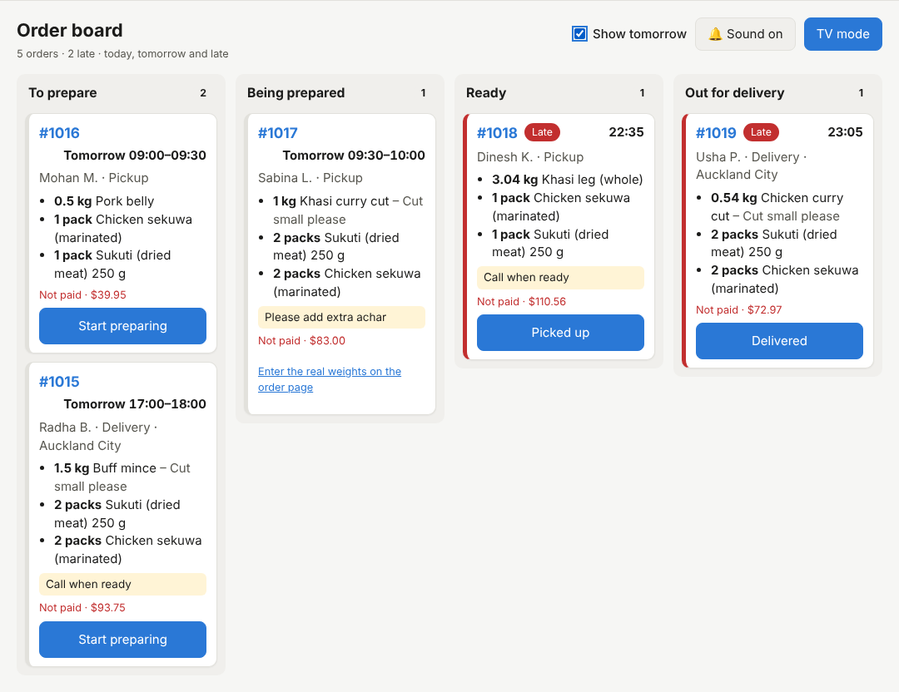
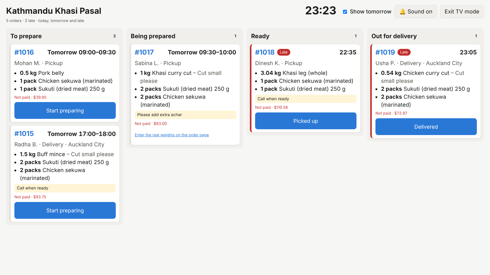

# 19. The order board

*User guide, chapter 19 · Last updated 22 October 2026*

**Who this is for:** counter and kitchen staff, and the owner or manager who sets up a screen in the shop.

The order board shows the orders to work on now, in four columns. It updates itself every 10 seconds. Staff move an order to its next step with one tap, and a short chime plays when a new order is confirmed.

## 19.1 Open the board

1. In the staff app (chapter 9), click **Board** in the menu. You need **Orders – View**. To move orders you also need **Orders – Edit** (Shop Staff and Business Owner have both).
2. To show the board on a TV or a big screen, click **TV mode**. The board fills the whole screen, with bigger text and a clock. Click **Exit TV mode** to go back.

The screen remembers **TV mode**, the sound and **Show tomorrow** in that browser.

## 19.2 What the board shows

| Column | Orders in it |
|---|---|
| **To prepare** | Confirmed |
| **Being prepared** | Being prepared, Final price sent, Final price accepted |
| **Ready** | Ready for pickup, Ready for delivery |
| **Out for delivery** | Out for delivery |

The board shows orders due **today**, **late** orders from earlier days, and orders without a time. Tick **Show tomorrow** to add tomorrow's orders too, for example to start the preparation early.

Drafts, orders waiting for the customer's confirmation, and completed, cancelled or expired orders are not on the board. Find them on the **Orders** page (chapter 6).

Each card shows:

- the order number (click it to open the order);
- the time: only the time for today (*10:00–10:30*), *Tomorrow 10:00* for tomorrow, and the date for earlier days;
- the customer's short name (*Sita R.*), and **Pickup**, or **Delivery** with the suburb;
- the products, amounts and product notes, and the order notes (in yellow);
- **Paid** or **Not paid** (in red), and the total.

**Late** orders have a red **Late** label and a red edge: the pickup or delivery time (or the end of the time slot) has passed, and the order is not finished. Late orders are at the top of each column, then the others by time. Orders without a time are at the bottom.

A new order has a blue edge for 2 minutes.

**Privacy:** customers may see the board, so it shows only the short name and the suburb. It never shows the street address or the phone number. Open the order for those.

## 19.3 Move an order on

Tap the button on the card:

| The card | Button | The order becomes |
|---|---|---|
| To prepare | **Start preparing** | Being prepared |
| Being prepared, nothing to weigh or the same price | **Ready for pickup** or **Ready for delivery** | Ready |
| Being prepared, the real weight changed the price | **Send final price** | Final price sent. The customer gets the new price on WhatsApp (chapter 17.3). |
| Being prepared, products sold by weight are not weighed yet | No button: *Enter the real weights on the order page* | Click the text, then enter the weights (chapter 6.4). |
| Final price sent | No button: *Waiting for the customer to accept the price* | – |
| Final price accepted | **Ready for pickup** or **Ready for delivery** | Ready |
| Ready for pickup | **Picked up** | Completed |
| Ready for delivery | **Out for delivery** | Out for delivery |
| Out for delivery | **Delivered** | Completed |

- The same rules apply as on the order page, and the customer gets the same WhatsApp messages (chapter 17.1).
- **Not paid:** for an order that is not paid, **Picked up** and **Delivered** need a second tap within 6 seconds (*Not paid yet. Tap again: Picked up*). Take the payment first: click the order number, then **Mark as paid** (chapter 6.5).
- A step cannot be undone on the board. Everything else (cancel, change the time, weights, payment, a delivery that did not happen) is on the order page.
- If a step is refused, the card shows the reason in red, for example when someone else already moved the order.

## 19.4 The chime

- A short chime plays when a new order arrives in **To prepare**: for example when a customer presses **Yes** on WhatsApp, or when staff confirm a phone order.
- There is no chime when the board opens or when you tick **Show tomorrow**, only for orders that arrive after that.
- Browsers only play sound after someone taps the page once. When the yellow note *Tap or click the board once…* shows at the bottom, tap anywhere on the board.
- Click **Sound on** to switch the chime off (**Sound off**), and again to switch it on.

## 19.5 Good to know

- If the connection is lost, a yellow note says *The board could not be updated*, with the time of the last update. The board keeps trying every 10 seconds.
- A login lasts **8 hours**. After that, the board says *Your login has ended*. Click **Log in again**. On a screen that is on all day, log in at the start of each shift.
- For a shared screen, use a staff account with only what it needs (for example the **Shop Staff** role), and log out when the shop closes.
- In the test businesses (chapter 16), four open orders are due today, and two of them are late, so the board has work on it.
