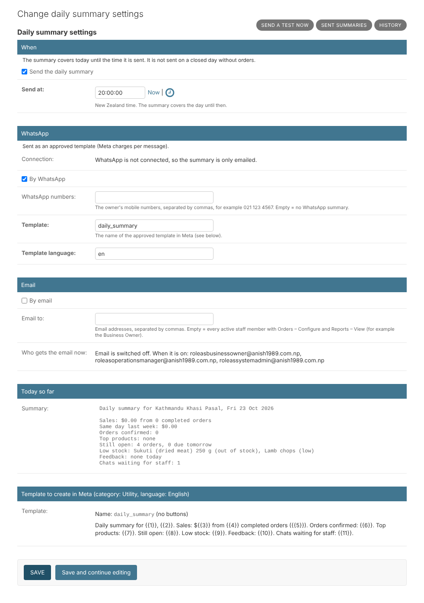
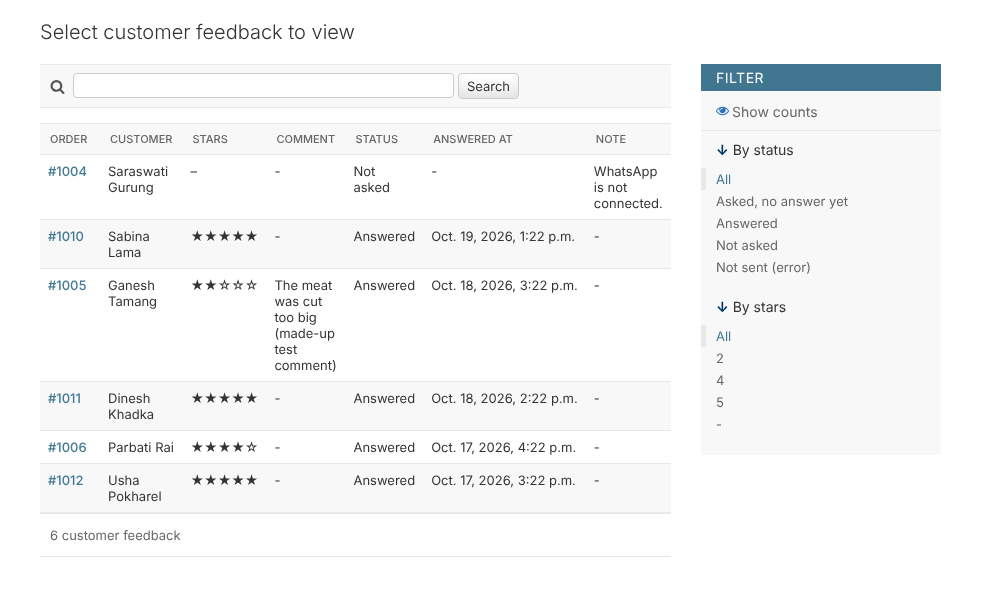

# 20. Daily summary and star feedback

*User guide, chapter 20 · Last updated 23 October 2026*

**Who this is for:** the business owner or manager who sets up the daily summary (sections 20.1–20.4), and everyone who wants to see what customers think of their orders (sections 20.5–20.8).

Every evening the owner gets a short **daily summary** of the day by WhatsApp and email. After each order, customers are asked on WhatsApp for **1 to 5 stars**.

## 20.1 What the daily summary says

For today, from midnight until the summary is sent:

| Line | What it means |
|---|---|
| Sales | Totals of orders **completed** today (picked up or delivered), NZ$ incl. GST and delivery fees, and how much of it is not paid yet. The same as the dashboard (chapter 8). |
| Same day last week | The sales of the same weekday last week, to compare. |
| Orders confirmed | Orders confirmed today that were not cancelled or expired. |
| Top products | The 3 products with the most sales today. |
| Still open | Orders confirmed but not finished yet, and how many are due tomorrow. |
| Low stock | Counted products that are low, out of stock or below zero (chapter 5.5). |
| Feedback | Star ratings customers gave today: how many, the average, and the low ones (1 or 2 stars) with their order numbers. |
| Chats waiting for staff | Chats the AI passed to staff that nobody answered yet (chapter 18.6). |

## 20.2 Set it up (Orders – Configure)

1. Go to **Reports and dashboard → Daily summary settings**.
2. **Send at:** the time it is sent, New Zealand time. Default **20:00**.
3. **By WhatsApp:** type the owner's mobile numbers, separated by commas (for example *021 123 4567*). Leave it empty for no WhatsApp summary.
4. **By email:** leave **Email to** empty to send it to everyone with **Orders – Configure** and **Reports – View** (for example the Business Owner), or type the email addresses. **Who gets the email now** shows the list.
5. Click **Save**.
6. To check it, click **Send a test now** (top right). It sends today's summary so far, marked *TEST*. The real summary is still sent at the normal time.

The summary is **not sent on a closed day** (a closed day, or a weekday without opening hours, chapter 15) when there were no orders at all. On an open day it is always sent, even when nothing was sold.

## 20.3 The WhatsApp template (in Meta)

The owner rarely writes to the business's WhatsApp number, so the summary is sent as an approved **template**. Create it in **Meta Business Suite → WhatsApp Manager → Message templates**:

- **Name:** *daily_summary* (or change the name in the settings). **Category:** Utility. **Language:** English (*en*). No buttons.
- **Text** (also shown at the bottom of the settings page):

  *Daily summary for {{1}}, {{2}}. Sales: ${{3}} from {{4}} completed orders ({{5}}). Orders confirmed: {{6}}. Top products: {{7}}. Still open: {{8}}. Low stock: {{9}}. Feedback: {{10}}. Chats waiting for staff: {{11}}.*

Meta may decide this template is *Marketing* instead of *Utility*; it still works, at the marketing price. Meta charges for **every** template message (chapter 17.7). Until the template is approved, the summary is only emailed.

## 20.4 Sent summaries (Reports – View)

**Reports and dashboard → Daily summaries** lists each day: **Sent**, **Partly sent** (for example the email went, but WhatsApp failed), **Not sent** with the reason, and the full text. A summary is made once a day; it is never sent twice.

## 20.5 Star feedback: when customers are asked

One hour after an order is **completed** (picked up or delivered), the customer gets: *Thank you for your order #1234 from … How was it? Please choose 1 to 5 stars.*

- Within 24 hours of the customer's last message: a list with **5 Excellent, 4 Good, 3 OK, 2 Poor, 1 Very poor**.
- Later: the approved template *order_feedback* with the same 5 buttons (section 20.7).

A customer is **not** asked when:

| Reason shown | Why |
|---|---|
| No customer with a phone number | Walk-in orders, or the customer's data was removed. |
| WhatsApp is not connected | Connect it (chapter 7.6). |
| The customer has never written to the business on WhatsApp | Phone and counter customers who never used WhatsApp. |
| The customer sent STOP | They do not want messages. |
| This customer was asked in the last 7 days | At most one question a week per customer. |

Orders completed more than 24 hours ago are never asked. Switch the questions off in **Orders → WhatsApp messages to customers → Ask for star feedback**.

## 20.6 The answers

- The customer chooses from the list or presses a button. They can also type a number (*4*, *4 stars*) when this is the only question open in their chat.
- **3 to 5 stars:** *Thank you for your feedback!*
- **1 or 2 stars:** *Sorry that your order … was not good. What went wrong?* The chat goes to **Inbox → Needs staff** (chapter 7.4), and managers get the usual email (chapter 18.6). The customer's next message is kept as the **comment**. Reply to the customer in the inbox.
- Only the first answer counts.

Where to see the stars:

- On the order, in the staff app (**Star feedback**) and in the admin.
- **Orders → Customer feedback**: every order's feedback, with filters for stars and status.

- The dashboard card **Feedback, last 7 days**: the average, the number of answers and the low ratings.
- The daily summary.

When a customer's personal data is removed (chapter 5), their comments are removed too. The stars stay, so the averages stay right.

## 20.7 The feedback template (in Meta)

For customers who wrote more than 24 hours ago. Create it like the order templates (chapter 17.6):

- **Name:** *order_feedback*. **Category:** Utility. **Language:** English.
- **Text:** *Thank you for your order #{{1}} from {{2}}. How was it? Please choose 1 to 5 stars.*
- **Quick-reply buttons**, in this order: **5 Excellent**, **4 Good**, **3 OK**, **2 Poor**, **1 Very poor**.

## 20.8 Good to know

- Both jobs run in the background: the summary is checked every 5 minutes, the feedback every 10 minutes. **Check system** (chapter 11) warns if the background jobs stop.
- In the test businesses (chapter 16), the feedback and yesterday's summary are **made up**. The summary email is switched off there and no WhatsApp numbers are set, so nothing is ever sent from a test business.
