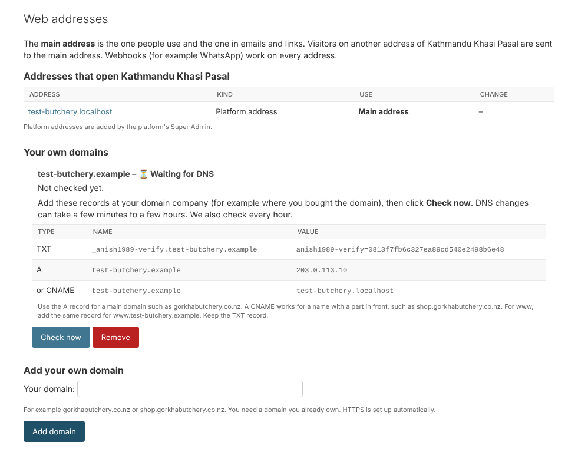

# 21. Your own domain

*User guide, chapter 21 · Last updated 23 October 2026*

**Who this is for:** the System Admin or IT Admin of a business who wants the business to open on its own domain, for example *gorkhabutchery.co.nz* (sections 21.1–21.5), and the person who runs the server (section 21.6).

Every business opens on a free platform address, for example *gorkhabutchery.\<platform\>*. You can add your own domain too. HTTPS (the lock in the browser) is set up automatically.

You need a domain you already own, bought from a domain company (for example a New Zealand registrar). You add two records there; this page tells you exactly which.

## 21.1 Add your domain (Settings – Configure)

1. Click **Web addresses** at the top of any admin page.
2. Under **Add your own domain**, type your domain, for example *gorkhabutchery.co.nz* (or a name such as *shop.gorkhabutchery.co.nz*). Leave out *www*: both the name and *www.* the name work.
3. Click **Add domain**. The domain shows **⏳ Waiting for DNS** with the records to add.

A business can have up to 3 own domains. The System Admin and the IT Admin can add them; the Business Owner can see them.

## 21.2 Add the DNS records at your domain company

Sign in at the company where you bought the domain, open its **DNS** settings, and add:

| Type | Name | Value | Why |
|---|---|---|---|
| **TXT** | *_anish1989-verify.yourdomain* | *anish1989-verify=* and your secret code | Proves the domain is yours. Keep it. |
| **A** | *yourdomain* | the server's IP address shown on the page | Sends visitors to the platform. Use this for a main domain such as *gorkhabutchery.co.nz*. |
| or **CNAME** | *shop.yourdomain* | your platform address | Use this instead of an A record for a name with a part in front, such as *shop.gorkhabutchery.co.nz*. |

For *www*, add the same A (or CNAME) record for *www.yourdomain*.

Copy the values from the page exactly. Some domain companies add your domain to the name by themselves: then type only *_anish1989-verify* (or *@* for the domain itself).

## 21.3 Check and go live

- Click **Check now** after adding the records. DNS changes can take a few minutes to a few hours. The system also checks every hour (after a week of waiting, once a day). You can click **Check now** once a minute.
- When both records are found, the domain is **✔ Live**. The System Admins and IT Admins get an email.
- The first visit to the domain takes a few seconds longer: the HTTPS certificate is made then.

A live domain opens your business, but visitors are still sent to the **main address**. To use your domain in emails and links, click **Make main address** next to it. Everyone who is signed in must sign in again on the new address.

## 21.4 When the DNS breaks

Every live domain is checked once a day. If it no longer points to the platform (for example after a change at your domain company):

- it shows **✖ DNS problem**, **Check system** shows it in red, and the System Admins and IT Admins get an email at once;
- it is checked every hour; when it works again, you get another email;
- if it is still broken after **3 days** and it is your main address, the **platform address becomes the main address again**, so customers can still reach you. Fix the DNS, then click **Make main address** again.

## 21.5 Remove a domain

Click **Remove** next to it and answer the safety question (chapter 16.5). The main address cannot be removed: make another address the main one first. You can then delete the DNS records at your domain company.

The platform's Super Admin sees every business's own domains on the business's **Web addresses** page (chapter 10) and can remove them too.

## 21.6 For the person who runs the server

- On a server, start the platform with **Caddy** in front: `docker compose --profile server up -d`. Caddy answers on ports 80 and 443 and gets free Let's Encrypt certificates. Before it asks for one, it asks the platform whether the name is a real address (a platform address, or a business's live own domain), so nobody can make the server ask for certificates for other names.
- Set in `.env`: **ACME_EMAIL** (Let's Encrypt writes there about problems) and **PLATFORM_SERVER_IPS** (the server's public IP addresses; empty = the addresses the platform domain points to).
- On a laptop, nothing changes: Caddy is not started, and own domains stay **Waiting for DNS**.
- The test businesses (chapter 16) each have a made-up domain ending in *.example*. Such names never exist on the internet, so they always wait for DNS.
