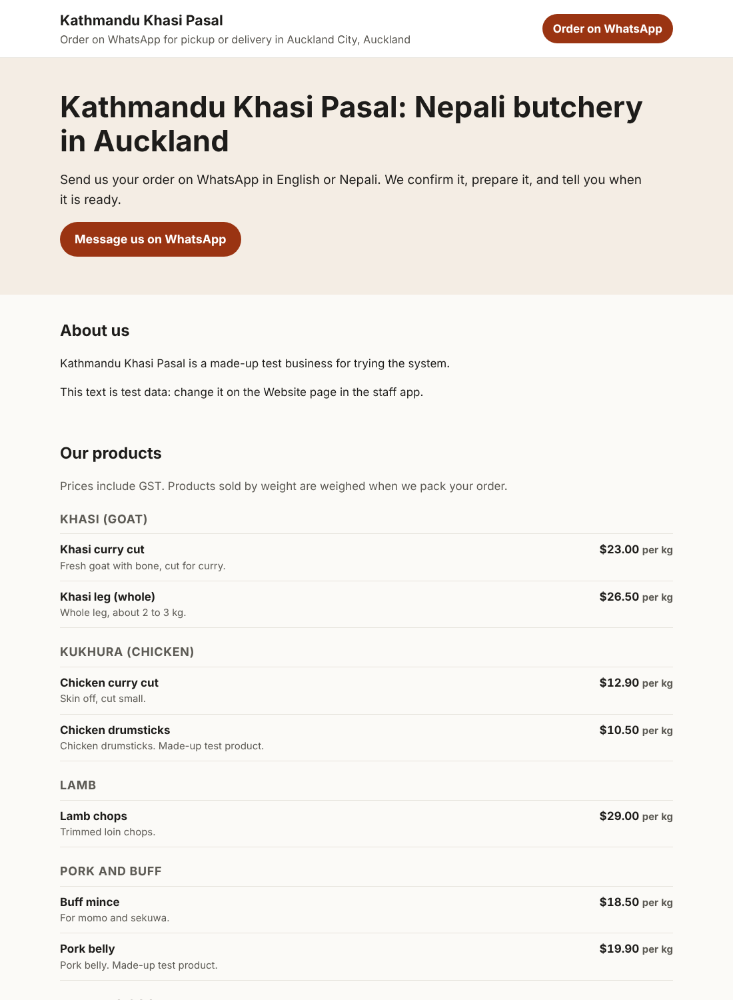
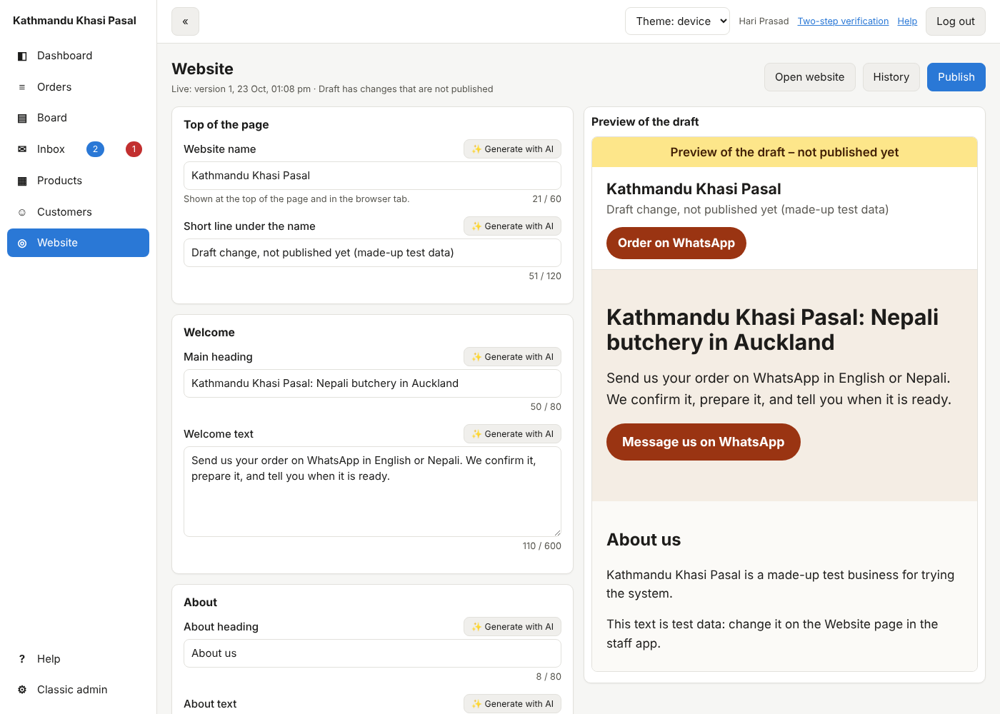

# 22. Your website

*User guide, chapter 22 · Last updated 23 October 2026*

**Who this is for:** the business owner or content manager who writes the website (Websites – Edit) and publishes it (Websites – Publish).

Every business has a one-page website at its main address (chapter 10, or your own domain, chapter 21). It shows your texts, plus your products and prices, opening hours, delivery areas and contact details, straight from the system, so they are always up to date.

## 22.1 What the page shows

From top to bottom:

| Part | Where it comes from |
|---|---|
| Website name and short line | Your texts |
| Welcome heading and text, with a **WhatsApp** button | Your texts; the button opens a WhatsApp chat with the number you set |
| About | Your texts |
| Products and prices | Products that are available and not archived (chapter 5), by category. Counted products that run out show **Sold out**. |
| Pickup hours, delivery hours, delivery areas, closed days | Pickup and delivery settings (chapter 15) |
| Contact | Your texts, plus the address, phone and email of the business (first-login setup, chapter 14) |
| Title and description in Google | Your texts (they are not shown on the page) |

The page never shows customers, orders, stock numbers or staff. Four switches hide the products, the hours, the delivery areas or the WhatsApp button.

Before anything is published, visitors see a first version made from your business details.

## 22.2 Change the texts (staff app → Website)

1. Open the staff app (chapter 9) and click **Website**.
2. Change a text on the left. The **preview** on the right shows the draft a moment later (on a phone, the preview is below the fields).
3. Each text has a limit, shown as *21 / 60*. A red number or text means it must be fixed before it is saved.
4. Changes are saved as a **draft** by themselves. Visitors do not see them yet.

Texts are plain text: no bold, no links. An empty line in a long text starts a new paragraph.

## 22.3 Generate with AI

Click **✨ Generate with AI** next to a text. The AI writes a suggestion from your business details, products and hours, and your other texts.

- Click **Use this** to put it in the draft, or **Discard**.
- Read it before you publish: the AI is told to use only your facts, but check prices, names and promises.
- It uses the business's AI key (chapter 18.2) and counts toward the monthly AI limit. Each suggestion is in the **AI log** (chapter 18.7). At most 30 suggestions an hour.
- Without an AI key, the button says how to add one.

## 22.4 Publish

Click **Publish** (Websites – Publish). The draft becomes the live website. The line under the title says which version is live and whether the draft has changes that are not published yet.

## 22.5 History

Click **History** to see the last 20 published versions, when and by whom. **Put in the draft** copies an older version into the draft; check the preview, then click **Publish** to make it live again.

## 22.6 Good to know

- **Open website** shows the live page in a new tab.
- Search engines find the page through *robots.txt* and *sitemap.xml*, made by the system. The page tells search engines its main address, so extra addresses never count twice.
- The website is part of the **Websites** module. When it is switched off, the address shows "not found".
- In the test businesses (chapter 16), version 1 is published with made-up texts, and the draft has one change that is not published yet.
