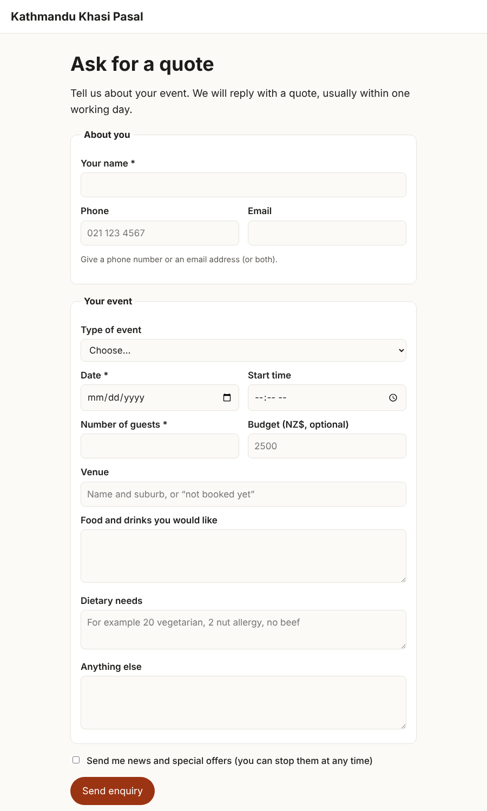
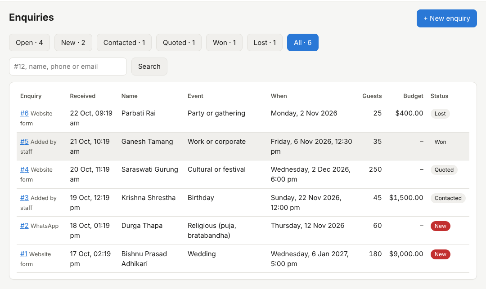
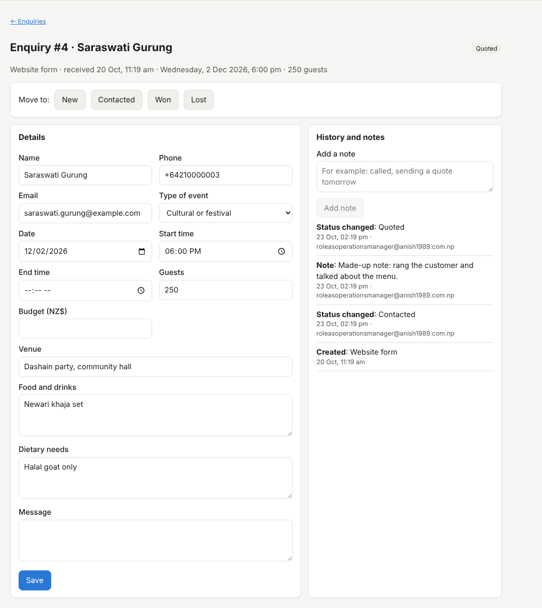

# 23. Event and catering enquiries

*User guide, chapter 23 · Last updated 23 October 2026*

**Who this is for:** staff who answer event and catering enquiries (Catering and events – View and Edit), and the owner who sets up the enquiry form.

An **enquiry** is a request for a quote: a wedding, a birthday, a puja, a work lunch or any other event. Enquiries come from three places:

| Where from | How |
|---|---|
| **Website form** | Customers fill in the form at */enquiry/* on your website (23.1). |
| **WhatsApp** | The AI assistant asks the event questions and saves the enquiry (23.5), or staff click **Make enquiry** in a chat (23.6). |
| **Staff** | Staff click **+ New enquiry** in the staff app, for example after a phone call. |

Enquiries need the **Catering and events** module. It is on for catering and events businesses; other businesses can switch it on (chapter 3).

## 23.1 The enquiry form on your website

Your website shows an **Ask for a quote** button. It opens the form at *your-address/enquiry/*. You can also share that link on Facebook, Instagram or in emails.

The form asks for:

- name, and a phone number or an email address (at least one);
- type of event, date, start time, number of guests and budget;
- venue, food and drinks, dietary needs and anything else;
- a tick box for news and offers (marketing consent; it is recorded with the date, chapter 5).

Name, phone or email, date and number of guests are required. The date cannot be in the past. After sending, the customer sees a thank-you page.

When the phone number or email address belongs to a customer you already have, the enquiry is added to that customer. Otherwise a new customer is made.

## 23.2 Form settings (Classic admin → Catering and events → Enquiry settings)

| Setting | What it does |
|---|---|
| **Website enquiry form** | Switch the form and the **Ask for a quote** button on or off. |
| **Form heading**, **Text above the form**, **Thank-you text** | Your own words on the form. |
| **Email staff about new enquiries** | One short email per new enquiry from the website or WhatsApp, to everyone with Catering and events – Edit. It has the name, the type of event, the date, the number of guests and a link, never the customer's message or dietary needs. |

Changing the settings needs Catering and events – Edit.

## 23.3 Spam protection

The form always has three checks that visitors do not see:

- a hidden field that people never fill in (robots do; they get the thank-you page, but nothing is saved);
- a time check: a form sent back within 3 seconds, or more than 2 hours after it was opened, is refused;
- limits: 5 enquiries an hour from one internet address, and 100 a day for the business.

## 23.4 Stronger spam protection with Cloudflare Turnstile (optional)

Cloudflare Turnstile is a free check that stops most robots without puzzles for people.

1. Sign in to Cloudflare (a free account is enough) and open **Turnstile**.
2. Click **Add widget**. Add every address of your website: your business address (for example *yourbusiness.anish1989.com.np*) and your own domain if you have one (chapter 21). Choose **Managed**.
3. Copy the **Site key** and the **Secret key**.
4. In the Classic admin, open **Integrations** (chapter 4) and add **Cloudflare Turnstile**. Paste both keys and click **Test connection**.

The form shows the Cloudflare check only when the test says **Connected**. If Cloudflare cannot be reached when a customer sends the form, the form asks them to try again, and nothing is saved.

## 23.5 Enquiries from the AI on WhatsApp

When the AI assistant is on (chapter 18), it also takes event enquiries:

- When a customer asks about an event, catering for a group or a quote, the AI asks for the type of event, date, start time, venue, number of guests, food and drinks, dietary needs and, if they want, the budget. It asks one or two things at a time.
- It saves the answers in one enquiry for that chat, and adds to it as the customer tells more.
- The AI never gives prices, packages or availability for events. When the details are there, it tells the customer that a staff member will send a quote.
- Once staff move the enquiry on from **New**, or after 14 days, a new question from the customer starts a new enquiry.

## 23.6 Make enquiry in the inbox

In a WhatsApp chat in the staff app, click **Make enquiry** (Catering and events – Create, and Customers – View). The app opens a new enquiry for the chat's customer. Fill in the details from the chat.

## 23.7 The enquiry list (staff app → Enquiries)

The tabs show how many enquiries are in each step. **Open** shows New, Contacted and Quoted together. Search by number (*#12*), name, phone or email.

| Status | Meaning |
|---|---|
| **New** | Nobody has answered yet (red). |
| **Contacted** | Someone has talked to the customer. |
| **Quoted** | A quote was sent. |
| **Won** | The customer booked. |
| **Lost** | The customer did not book. You must give a short reason, for example "booked another caterer". |

## 23.8 One enquiry

- **Move to:** change the status.
- **Details:** change any detail and click **Save**. Only the fields you changed are saved, so two people can work on the same enquiry.
- **Still needed for a quote** lists the missing details: type of event, date, start time, venue, number of guests, food and drinks.
- **History and notes:** every change, with who made it and when. Add notes such as "called, sending a quote tomorrow".
- **Open the WhatsApp chat** appears for enquiries from WhatsApp.

## 23.9 Good to know

- Enquiries hold personal details. When a customer's personal data is removed (chapter 5), the names, contact details, venue, food, dietary needs, messages and notes of their enquiries are removed too. The dates and numbers stay for reports.
- The audit log records each new enquiry, change (only the names of the fields), status change and note, never the details themselves.
- Quotes from enquiries come in the next task (3.2).
